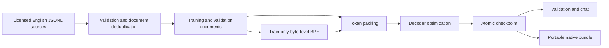

# Architecture

Clearforge separates data construction from optimization. A training run consumes
immutable token arrays and a tokenizer identity; it does not download datasets or
change the tokenizer while optimizing a model.

## Component ownership

| Component | Responsibility |
|---|---|
| `config` | Immutable dimensions, optimization settings, path resolution |
| `data` | Record validation, provenance, split construction, packed storage |
| `tokenizer` | Byte-level BPE, role delimiters, assistant supervision |
| `model` | Decoder computation, causal loss, bounded generation |
| `checkpoint` | Durable state and compatibility checks |
| `training` | Optimizer steps, validation, recovery, metrics, export |
| `cli` | Argument parsing, actionable errors, command composition |

The decoder uses pre-normalization with RMSNorm, rotary position embeddings,
grouped-query attention, a SwiGLU feed-forward layer, and causal scaled-dot-product
attention. Input/output embeddings can share parameters. The model applies the
next-token shift exactly once; dataset labels remain aligned with input IDs.

For supervised chat, the prompt is context but not a prediction target. User,
system, and padding positions have label `-100`. Structural role delimiters are
controlled by the tokenizer rather than interpreted from untrusted message text.

## Recovery boundary

An optimizer update is the durable progress boundary. A resumable checkpoint must
include optimizer state, scheduler position, random state, data order and cursor,
as well as model weights. Reusing weights alone starts a new optimization run;
it does not reproduce a previous run's trajectory.

## Initial release boundary

The first release targets single-process training on one CPU or one CUDA device.
It supports native-model pretraining and full-parameter supervised fine-tuning.
Distributed execution, adapter tuning, external pretrained-model formats, and
production serving are not part of this interface. Exported native bundles are
for Clearforge inference, not interchangeable model-serving formats.
